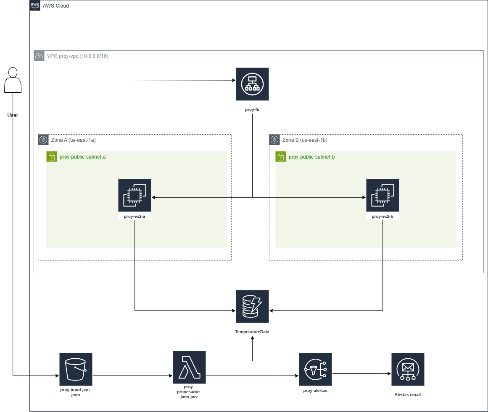

# AquaSenseCloud: a serverless data pipeline and highly available API on AWS

An AWS system that ingests weekly temperature-sensor CSV files, processes them event-driven with Lambda, stores monthly aggregates in DynamoDB, sends real-time email alerts on anomalies through SNS, and serves the results through a REST API. The API runs on two EC2 instances in different Availability Zones behind an Application Load Balancer, and the network and web tier are defined as code with **CloudFormation**.

> Final project for *Infraestructura para la Computación de Altas Prestaciones* (BSc in Data Science and Engineering, Universidad Politécnica de Cartagena).



## Architecture

| Layer | Service | Role |
|---|---|---|
| Ingestion | **Amazon S3** | Stores raw CSV uploads; each `.csv` upload triggers the processing Lambda |
| Processing | **AWS Lambda** (Python 3.12) | ETL: parse → validate → merge with existing state → aggregate by month → write to DynamoDB |
| Storage | **Amazon DynamoDB** | Table `TemperatureData`, partition key `Fecha` (`YYYY/MM`), so each API query is a single key lookup |
| Alerting | **Amazon SNS** | Emails an alert right away for every week whose standard deviation is above 0.5 |
| Serving | **EC2 ×2 + ALB** | Flask REST API in two AZs (`us-east-1a`, `us-east-1b`), with health checks on `/health` |
| IaC | **CloudFormation** | VPC, subnets, IGW, routes, security groups, launch template, EC2, ALB, target group, listener |

### Design decisions

- **Lambda rather than an always-on server for processing.** Uploads are infrequent and bursty. Lambda is billed per millisecond and scales out on its own when many files arrive at once.
- **Incremental read-merge-write ingestion.** Different files can bring weeks of the same month, can arrive out of order and can repeat dates. For each affected month the Lambda reads the stored weeks, merges in the new ones (the latest file wins on duplicate dates) and recalculates the aggregates. It then recalculates the month-over-month difference (`MaxDiff`) for the whole table, so no history is lost.
- **Robust date parsing.** The source data mixes `YYYY/MM/DD` and `DD/MM/YYYY`, with and without zero padding, and with `-` or `/` as separator.
- **DynamoDB key-value design.** Every API query has the form "give me X for year/month", which maps directly to a `GetItem` on the partition key.
- **High availability.** Two instances in separate AZs behind an ALB. The ALB stops routing to an instance if its health check fails.
- **Self-healing web service.** EC2 User Data installs the dependencies, writes the Flask app and registers it as a **systemd** service (`Restart=always`, enabled at boot). It survives reboots and crashes with no SSH needed.
- **Least exposure.** The EC2 security group accepts HTTP only from the load balancer's security group.

## Repository structure

```
infrastructure/cloudformation.yaml   # Network + web tier (VPC, 2 subnets, SGs, launch template, 2×EC2, ALB)
lambda/lambda_function.py            # S3-triggered ETL + SNS alerts + DynamoDB writes
webapp/app.py                        # Flask REST API (also embedded in the template's User Data)
sample-data/example_input.csv        # Input format example
docs/architecture.png                # Architecture diagram
```

## REST API

All endpoints take `year` and `month` as query parameters.

| Endpoint | Returns |
|---|---|
| `GET /temp?year=2024&month=5` | Monthly mean temperature (`temp_media`) |
| `GET /maxdiff?year=2024&month=5` | Difference in maximum temperature vs the previous month (`max_diff`) |
| `GET /sd?year=2024&month=5` | Maximum weekly standard deviation in the month (`max_desviacion`) |
| `GET /health` | Health check for the ALB |

## Input format

```csv
Fecha,Medias,Desviaciones
2017/03/05,14.21,0.32
2017/03/19,15.87,0.58   <- deviation > 0.5 triggers an SNS alert
```

## Deployment

Region: `us-east-1`. The project was built on AWS Academy, which provides the `LabRole` and `LabInstanceProfile` IAM roles. On a regular account, create equivalent roles.

1. **Key pair.** Create an EC2 key pair named `proy-icap-keypair`, or pass your own name as the `KeyName` parameter.
2. **Network and web tier.** Create a CloudFormation stack from `infrastructure/cloudformation.yaml`. The load balancer's DNS name appears in the stack **Outputs**.
3. **Data resources**:
   - DynamoDB: table `TemperatureData`, partition key `Fecha` (String).
   - S3: an input bucket.
   - SNS: a standard topic `proy-alertas` with a confirmed email subscription.
4. **Lambda.** Python 3.12 runtime, code from `lambda/lambda_function.py`, a 3-minute timeout, an IAM role with S3 read, DynamoDB read/write and SNS publish permissions, and these environment variables:
   - `SNS_TOPIC_ARN`: the ARN of the topic you created.
   - `DYNAMO_TABLE`: optional, defaults to `TemperatureData`.

   Add an S3 trigger on the input bucket for object creation with suffix `.csv`.
5. **Test.** Upload a CSV to the bucket and check for the alert emails, the new DynamoDB items and `http://<alb-dns>/temp?year=...&month=...`.

## Verification carried out

- **Ingestion and alerts**: uploading a CSV produced one SNS email per week with a deviation above 0.5.
- **Incremental ingestion**: a second file added a week to an existing month and overwrote a repeated date. The month kept all its weeks, its aggregates were recalculated and the next month's `MaxDiff` was updated.
- **High availability**: the ALB alternated requests between both instances.
- **Persistence**: after rebooting both EC2 instances, the API came back with no manual intervention.

## Authors

- Javier Muñoz Vera
- Javier Martínez Manresa
